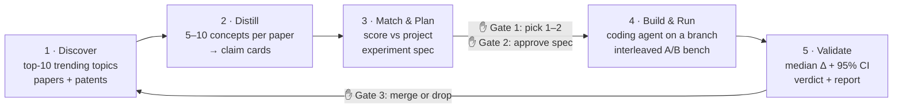

# PaperAtlas

PaperAtlas finds new research, turns it into testable claims, tries the best ones in **your**
project, and checks whether the claimed gain is real.

**Research → Experiment** loop (plan: [`.docs/research-to-experiment-plan.html`](.docs/research-to-experiment-plan.html)):



- **Discover** — auto-picks the top trending topics inside the seed areas in
  [`src/paperatlas/config/r2e.yaml`](src/paperatlas/config/r2e.yaml) using arXiv, Semantic Scholar,
  OpenAlex, Hugging Face Papers and USPTO patents; ranks papers per topic and fetches full text.
- **Distill** — one structured LLM call per paper produces technical concepts, each with a
  *claim card*: technique, change required, claimed effects (value/unit/direction/baseline),
  paper setup, prerequisites (CUDA, multi-GPU, training), effort, risks and a verbatim evidence quote.
  Near-duplicate claims across papers are grouped.
- **Match & Plan** — claims are scored against the target project's profile (`lab.yaml`): fit,
  claimed gain, effort, hardware blockers and past verdicts. A planner writes the experiment spec
  (hypothesis, flag, metric, workload, rounds, success bar, guardrails).
- **Build & Run** — a coding agent (GitHub Copilot CLI by default, Codex supported) implements the
  technique behind a feature flag in a git worktree; tests and a smoke A/B must pass; then an
  interleaved (ABBA) A/B benchmark runs on the eval model. Only one benchmark uses the GPU at a time.
- **Validate** — paired deltas, bootstrap 95% CI and quality guardrails give a verdict:
  `reproduced`, `partial`, `not_reproduced` or `regression`, with an HTML report (and a draft PR if
  the target repo has a GitHub remote).

## Architecture

[Interactive architecture field guide](docs/architecture.html) — open the HTML file locally.
The system context diagram opens directly to **System map · all connections**, grouped into clients,
the PaperAtlas application, persistence and integrations. Select a block to inspect its execution
and data flow, code-health evidence and suggested improvements. The [agentic workflow diagram](docs/architecture.html#agent-workflow) separates
model proposals, coding-agent changes, measured verdicts and human decisions, including retry paths.
On the expanded system map, hover or keyboard-focus a block to highlight its connections.
A filled dot on a routed wire marks a connected branch; a gap means two lines cross without connecting.
Moving arrows show direction; motion can be paused and starts off for reduced-motion users.
The guide works offline; only its source links need a connection.

| Service | Port | Role |
|---|---|---|
| `gateway` | 8100 | Web console (`web/`) + proxy for `/api/research/*` and `/api/lab/*` |
| `research-api` | 8101 | Topics, papers, claim cards, hybrid search; queues discover/distill jobs |
| `lab-api` | 8102 | Projects, recommendations, experiments, the three gates, live events (SSE) |
| `worker` | — | Executes jobs from the Postgres queue; runs LangGraph graphs until the next gate |

Storage is **PostgreSQL 18 + pgvector**: `research.*` (topics, papers, concepts, claims, groups),
`lab.*` (projects, matches, triage, experiments, runs, verdicts, jobs, events) and `agent.*`
(LangGraph checkpoints). Hybrid search fuses full-text (`tsvector`) and vector (HNSW) rankings
with reciprocal-rank fusion.

## Setup

```bash
brew install uv postgresql@18 pgvector node
brew services start postgresql@18
createdb paperatlas

uv venv --python 3.12 && source .venv/bin/activate
uv pip install -e .
cp .env.example .env          # add OPENAI_API_KEY (and optional source API keys)
paperatlas db upgrade
(cd web && npm install && npm run build)
```

## Run the web console

```bash
paperatlas services up        # http://127.0.0.1:8100
```

For frontend development run `npm run dev` in `web/` (Vite proxies `/api` to the gateway).

If the machine restarts or the app is closed mid-experiment, the next `paperatlas services up` resumes the
interrupted work from its last completed step: jobs that failed while the previous worker was shutting down
(within `PAPERATLAS_SHUTDOWN_WINDOW_S`, default 120 s) and experiments left without a job are re-queued.
Failures from before the shutdown stay failed. A `paperatlas r2e batch` run has to be started again.

To search for new papers and test them every day (at 00:00 here), install the daily run:

```bash
paperatlas r2e schedule --daily --hour 0 --install   # launchd; --remove to uninstall
paperatlas r2e daily --project inference-lab         # the same run, now
```

It starts the services if no worker is alive, scans (topics → discover → distill → match; papers already in the
database are not fetched or distilled again), explains new testable claim cards, and starts a background batch
for claims not yet tested on the current engine unless a batch is already running (only one runs per project; a
running batch picks up new claims itself). Its log is `data/logs/daily.log`.

## Command line

The CLI uses the same service layer and job queue as the console, so either can approve a gate.

```bash
paperatlas r2e project add ~/development/inference-lab     # target project with a lab.yaml
paperatlas r2e scan --project inference-lab --refresh-topics  # topics → discover → distill → match
paperatlas r2e recommend --project inference-lab           # ranked claim cards
paperatlas r2e pick 42 --project inference-lab             # Gate 1
paperatlas r2e show 1                                      # spec, stages, events
paperatlas r2e approve 1 --set rounds=12                   # Gate 2 (or: revise --comment …, reject)
paperatlas r2e watch 1                                     # follow progress to the next gate
paperatlas r2e merge 1                                     # Gate 3 (or: drop)
paperatlas r2e status --filter needs_you
```

Without `paperatlas services up`, run jobs with `paperatlas r2e worker` (or add `--inline`).
Individual stages: `paperatlas r2e topics refresh`, `paperatlas r2e discover`,
`paperatlas r2e distill`, `paperatlas r2e claims --q "kv cache"`, `paperatlas r2e match`,
`paperatlas r2e digest --project inference-lab` (weekly HTML digest).

## Target project contract

A target project describes itself in a `lab.yaml` at its root: `hardware` (e.g. `cuda: false`),
`models` (`smoke` and `eval`), `metrics` (name + `higher_is_better`/`lower_is_better`),
`workloads`, `extension_points`, `constraints`, and `commands` (`install`, `test`, `list_flags`,
`bench_ab` with `{model}` `{flags}` `{workload}` `{rounds}` `{out}` placeholders). `bench_ab` must
write a JSON file with interleaved per-round metrics per arm, quality results and environment info
(see `paperatlas.lab.runner.validate_results`). Each research technique is a feature flag that is
off by default.

## Configuration

Environment variables (or `.env`, see [`.env.example`](.env.example)):
`OPENAI_API_KEY`/`PAPERATLAS_LLM_API_KEY`, `PAPERATLAS_LLM_MODEL`, `PAPERATLAS_DATABASE_URL`,
`PAPERATLAS_S2_API_KEY`, `PAPERATLAS_OPENALEX_API_KEY`, `PAPERATLAS_USPTO_API_KEY`,
`PAPERATLAS_BUILDER` (`copilot`/`codex`), service ports and worker concurrency.
Without source keys, Semantic Scholar is rate limited and patents are skipped.

`PAPERATLAS_LLM_PROVIDER` selects the LLM: `openai` (needs `OPENAI_API_KEY`), `copilot` (the GitHub
Copilot CLI, no key), or an ordered fallback list such as `openai,copilot`, which uses Copilot when an OpenAI
request fails (for example, an expired key or no quota). When it is unset, OpenAI is used if a key is set.
`PAPERATLAS_COPILOT_LLM_MODEL` / `PAPERATLAS_BUILDER_MODEL` pick the Copilot models (the CLI default otherwise);
`PAPERATLAS_COPILOT_CONTEXT` and `PAPERATLAS_COPILOT_REASONING_EFFORT` apply to every Copilot CLI call.

## Paper ingestion (single papers)

```bash
python -m paperatlas.concepts.extraction.ingest --query "graph neural networks" --last-days 365 --max-results 50
python -m paperatlas.concepts.extraction.ingest --arxiv 2106.09685
python -m paperatlas.concepts.extraction.generate --limit 50               # same as `paperatlas r2e distill`
```

Papers, claim cards and the LLM response cache (`research.llm_cache`) all live in PostgreSQL;
`PAPERATLAS_DATA_DIR` only holds experiment worktrees, run logs/artifacts, reports and digests.

## Tests

```bash
createdb paperatlas_test
python -m pytest src/paperatlas        # DB tests use PAPERATLAS_TEST_DATABASE_URL (default: local paperatlas_test)
```

## Other modules

The original scaffold (embeddings, GNN/ranking models, recommender and the stub API in
`paperatlas.api`, run with `uvicorn paperatlas.api.main:app`) is unchanged and independent of the
Research → Experiment services.
